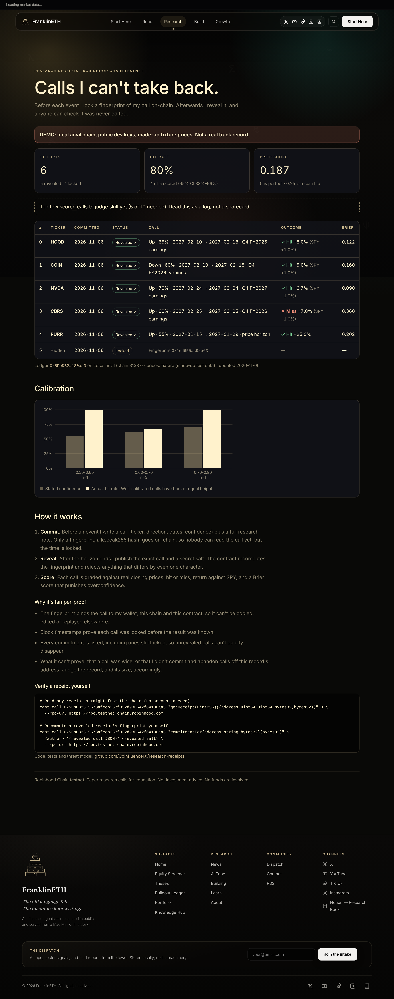
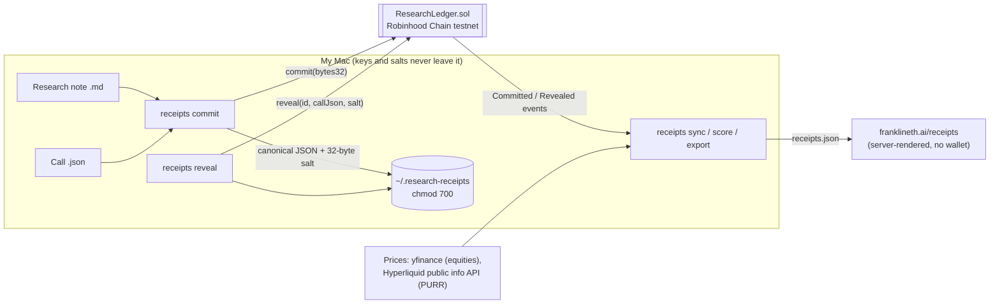

# Research Receipts

**A tamper-proof track record of research calls, locked on Robinhood Chain before the event and revealed after.**

[](https://github.com/CoinfluencerX/research-receipts/actions/workflows/ci.yml)

-ccff00)


Anyone can claim a great call after the fact. A research track record is only worth something if it can't be edited. Research Receipts makes that checkable:

1. **Commit.** Before an earnings report or price horizon, I write a call (ticker, direction, dates, confidence) and a research note. Only a keccak256 fingerprint goes on-chain: nobody can read the call, but the time is locked.
2. **Reveal.** After the horizon ends, I publish the call and a secret salt. The contract recomputes the fingerprint and rejects anything that differs by a single byte.
3. **Score.** Calls are graded against real closing prices: hit or miss, return against SPY, Brier score, and calibration.

The public record lives at **[franklineth.ai/receipts](https://franklineth.ai/receipts)**.


<sub>Screenshot of the site page rendering the **demo** record from `scripts/demo_anvil.py`: real contract and CLI on a local chain, with made-up fixture prices. The live page shows only real receipts.</sub>

---

## Architecture



| Piece | What it does |
|---|---|
| [`src/ResearchLedger.sol`](src/ResearchLedger.sol) | ~70-line commit-reveal ledger. No funds, no owner/admin, no upgrades, no external calls. |
| [`script/Deploy.s.sol`](script/Deploy.s.sol) | Deploys to Robinhood Chain testnet (46630) or local anvil (31337) only; refuses every other chain. |
| [`receipts/`](receipts) | Python CLI (stdlib only): `init`, `template`, `commit`, `reveal`, `sync`, `score`, `export`, `status`. Pure-Python keccak256 and ABI encoding, cross-checked against Foundry's `cast`. |
| [`receipts/scoring.py`](receipts/scoring.py) | Point-in-time scoring: hit/miss, excess vs SPY, Brier score, calibration buckets, Wilson 95% interval. |
| [franklineth.ai/receipts](https://franklineth.ai/receipts) | Site page rendered from the exported `receipts.json` (code lives in the site repo). |

## The commitment

```solidity
commitment = keccak256(abi.encode(author, block.chainid, address(this), keccak256(bytes(callJson)), salt))
```

- **`callJson`** is canonical JSON (sorted keys, no whitespace, UTF-8), so the exact bytes are reproducible:
  ```json
  {"asset_type":"equity","baseline":"close on horizon_start_date","confidence":0.65,"created_at":"2027-01-20T14:00:00Z","direction":"up","event":"Q4 FY2026 earnings","horizon_end_date":"2027-02-18","horizon_start_date":"2027-02-10","thesis_sha256":"<sha256 of the research note>","ticker":"HOOD"}
  ```
- **`salt`** is 32 random bytes, so a short call can't be brute-forced from its hash before reveal.
- **`author`, `chainid` and the ledger address** are inside the hash, so a commitment can't be copied by another wallet, or replayed on another chain or contract. Tests cover each case.

## Threat model

| What a receipt proves | How |
|---|---|
| The call existed, unchanged, at commit time | Block timestamp of `Committed`; any edit changes the hash and `reveal` reverts |
| It's mine | `msg.sender` is in the hash; only the author can reveal |
| The research note wasn't swapped later | The note's SHA-256 is a field of the committed call |
| Nothing is cherry-picked *from this ledger* | Every commitment is listed, revealed or not; locked receipts stay visible on the page |

| What it does **not** prove | Mitigation |
|---|---|
| That a call was smart | That's what the scoring is for. Under 10 scored calls the page says "too few to judge". |
| That I didn't make calls from *other* wallets and only reveal winners here | One published author address; post every commit link publicly when it happens |
| That a committed call is ever revealed | Unrevealed receipts are shown as "Locked" with their commit date; old locked receipts are a visible red flag |
| Price data correctness | Public, reproducible sources (yfinance, Hyperliquid info API); scores can be recomputed by anyone from the revealed calls |
| Testnet permanence | Robinhood Chain **testnet** is for demonstration; it can reset. The export keeps tx hashes for the record. |

## Verify a receipt yourself

No account or API key needed, just [Foundry](https://getfoundry.sh)'s `cast` and the ledger address shown on the site:

```bash
RPC=https://rpc.testnet.chain.robinhood.com     # official public testnet RPC (docs.robinhood.com/chain/connecting)
LEDGER=<ledger address from franklineth.ai/receipts>

# 1. Read a receipt: (author, committedAt, revealedAt, commitment, callHash)
cast call $LEDGER "getReceipt(uint256)((address,uint64,uint64,bytes32,bytes32))" 0 --rpc-url $RPC

# 2. Recompute the fingerprint from the revealed call + salt and compare with field 4 above
cast call $LEDGER "commitmentFor(address,string,bytes32)(bytes32)" <author> '<revealed call JSON>' <revealed salt> --rpc-url $RPC

# 3. Or recompute it fully offline
cast keccak $(cast abi-encode "f(address,uint256,address,bytes32,bytes32)" \
  <author> 46630 $LEDGER $(cast keccak '<revealed call JSON>') <revealed salt>)
```

## Scoring

- **Baseline:** the close on `horizon_start_date` (or the last close before it). **Outcome:** the last close on or before `horizon_end_date`. Nothing after the horizon is ever used.
- **Hit:** price moved in the called direction. Equities also show the SPY return over the same window and the excess return.
- **Brier score:** mean of (confidence − outcome)². 0 is perfect; always saying 50% scores 0.25.
- **Calibration:** confidence buckets (0.50–0.60 … 0.90–1.00), with stated confidence vs. actual hit rate.
- **Hit rate** with a Wilson 95% interval. Fewer than 10 scored calls are flagged "too few to judge".

## Run it

```bash
git clone --recurse-submodules https://github.com/CoinfluencerX/research-receipts && cd research-receipts
forge test                                   # 23 tests: unit, 5 fuzz properties x1000 runs, deploy guard
python3 -m venv .venv && .venv/bin/pip install -e '.[dev]'
.venv/bin/pytest -q                          # 44 tests, incl. a full commit→reveal→sync→score→export on anvil
.venv/bin/python scripts/demo_anvil.py       # regenerate docs/demo/receipts.demo.json on a throwaway local chain
```

To use it for real (new testnet wallet, faucet, deploy, verify, first commit), follow **[docs/DEPLOY-MAC.md](docs/DEPLOY-MAC.md)**. The January plan is in **[docs/FIRST-CALLS.md](docs/FIRST-CALLS.md)**.

## Security

- **Testnet only.** The deploy script and the CLI both refuse anything but chain 46630 (or local 31337).
- **Keys never touch this code.** Transactions go through Foundry's encrypted keystore (`--account`). The keystore password comes from a prompt, the macOS Keychain, or an env var, and reaches `cast` through a 0600 temp file that's deleted immediately (not `argv`). Anvil's public dev key is refused on any real chain.
- **Salts and unrevealed calls** stay in `~/.research-receipts/` (chmod 700, files 0600) and are never exported. A test checks that the public file contains nothing about a locked call.
- **Secret scan** ([`scripts/secret_scan.py`](scripts/secret_scan.py)): a pre-commit hook (`git config core.hooksPath .githooks`) and a CI step block private keys, keystores, mnemonics, password env vars, and unrevealed salts.
- The contract holds no funds and has no admin.

## Compliance note

These are **paper research calls for education, not investment advice**. They're general and impersonal, and no money is involved. If I join a bank, broker-dealer or research firm, publishing stock calls may be restricted by its compliance policies (and by FINRA research-analyst rules for registered roles); I'll check before continuing the public record.

## Network

| | Robinhood Chain testnet |
|---|---|
| Chain ID | 46630 (confirmed live: `cast chain-id` returned 46630; the live node executed the contract's creation code and returned byte-identical runtime code) |
| RPC | `https://rpc.testnet.chain.robinhood.com` |
| Explorer | `https://explorer.testnet.chain.robinhood.com` |
| Source | [docs.robinhood.com/chain/connecting](https://docs.robinhood.com/chain/connecting) |

## Layout

```
src/ResearchLedger.sol        contract
test/                         Foundry tests (unit + fuzz + deploy guard), .gas-snapshot
script/Deploy.s.sol           testnet-only deploy
receipts/                     Python CLI (keccak, abi, calls, rpc, wallet, prices, scoring, cli)
tests/                        pytest (format, crypto vs cast, scoring, secret scan, anvil end-to-end)
scripts/demo_anvil.py         full demo on a local chain → docs/demo/receipts.demo.json
docs/                         SPEC, DEPLOY-MAC, FIRST-CALLS, screenshots
```

MIT licensed. Built by [Franklin](https://franklineth.ai) as part of an equity-research portfolio.
